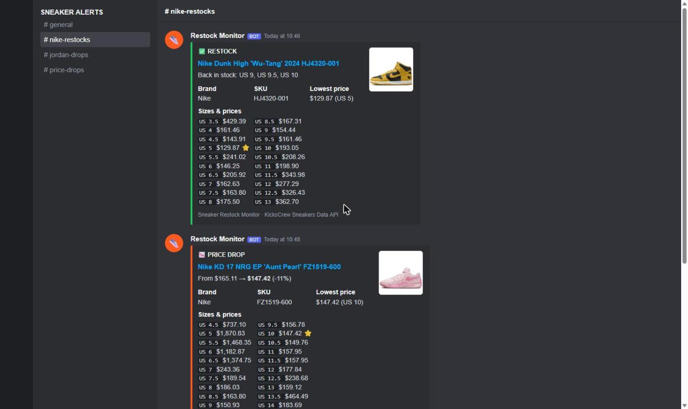

# 🔔 Sneaker Restock Monitor — Discord alerts for new drops, restocks & price drops

[](https://rapidapi.com/belchiorarkad-FqvHs2EDOtP/api/kickscrew-sneakers-data)
[](https://t.me/pintoflow)


> 🔑 **Data:** **[KicksCrew Sneakers Data API on RapidAPI](https://rapidapi.com/belchiorarkad-FqvHs2EDOtP/api/kickscrew-sneakers-data)**
>
> 💬 **Support on Telegram: [@pintoflow](https://t.me/pintoflow)** — fastest response for questions, bugs or custom monitors.

A **sneaker monitor** written in Python. It watches KicksCrew **collections** (Nike, Jordan, Yeezy, New Balance…) and **keywords** and sends rich **Discord webhook** alerts with the image, SKU, lowest price and **the price of every in-stock size** when:

- 🆕 a **new product** appears
- ✅ a size comes **back in stock** (restock)
- 📉 the lowest price **drops** by X %

No scraping, no proxies, no captchas — it uses a stable JSON API.



*Alerts rendered from real KicksCrew product data ([docs/discord-preview.html](docs/discord-preview.html)).*

## Quick start

```bash
git clone https://github.com/BelNaruto/sneaker-restock-monitor
cd sneaker-restock-monitor
pip install -r requirements.txt
cp config.example.yaml config.yaml          # choose collections, keywords, sizes
export RAPIDAPI_KEY=your-key                # https://rapidapi.com/belchiorarkad-FqvHs2EDOtP/api/kickscrew-sneakers-data
export DISCORD_WEBHOOK_URL=https://discord.com/api/webhooks/...
python monitor.py                           # runs forever (every interval_seconds)
python monitor.py --once                    # one pass (cron)
```

The first run silently builds a baseline (`state.json`) so your channel isn't spammed.

## Configuration (`config.yaml`)

```yaml
collections: [nike, jordan]       # KicksCrew collection slugs
pages_per_collection: 2           # 24 products per page
keywords: ["travis scott", "yeezy 350"]
title_filter: []                  # e.g. ["dunk", "jordan 4"]
sizes: ["9", "9.5", "10", "10.5"] # only alert for these US sizes ([] = all)
price_drop_percent: 5
interval_seconds: 300
```

## Run it for free

- **GitHub Actions** — included workflow `.github/workflows/monitor.yml` runs every 15 min. Add secrets `RAPIDAPI_KEY` and `DISCORD_WEBHOOK_URL`; state is kept with the Actions cache.
- **Docker** — `docker build -t sneaker-monitor . && docker run -e RAPIDAPI_KEY=... -e DISCORD_WEBHOOK_URL=... -v $PWD/data:/data sneaker-monitor`
- **Cloud Run Jobs / any VPS / Raspberry Pi** — `python monitor.py --once` on a schedule.

## How it works

| What | API endpoint |
|---|---|
| Collection products + every size/price | `GET /product/bycollection/v2?collection=nike&page=1&perPage=24&currency=USD` |
| Keyword search | `GET /search/v2?query=…` + `GET /product/description/byslugs?handle=…` |

Each cycle compares in-stock sizes and the lowest price with the previous snapshot and posts up to 10 embeds per Discord message. Full API reference: [**kickscrew-sneakers-api**](https://github.com/BelNaruto/kickscrew-sneakers-api).

## Related projects

- [sneaker-price-tracker](https://github.com/BelNaruto/sneaker-price-tracker) — web app with price-by-size charts and a watchlist
- [sneaker-price-telegram-bot](https://github.com/BelNaruto/sneaker-price-telegram-bot) — Telegram bot with price alerts
- [kickscrew-sneakers-api](https://github.com/BelNaruto/kickscrew-sneakers-api) — API docs & examples

---

💬 **Support on Telegram: [@pintoflow](https://t.me/pintoflow)** · 🔑 **API:** [https://rapidapi.com/belchiorarkad-FqvHs2EDOtP/api/kickscrew-sneakers-data](https://rapidapi.com/belchiorarkad-FqvHs2EDOtP/api/kickscrew-sneakers-data)

**Keywords:** sneaker monitor, restock monitor, sneaker restock alerts, discord sneaker monitor, discord webhook monitor, nike restock monitor, jordan restock, sneaker bot, price drop alert, kickscrew api.

MIT License · Not affiliated with KicksCrew or Discord.
